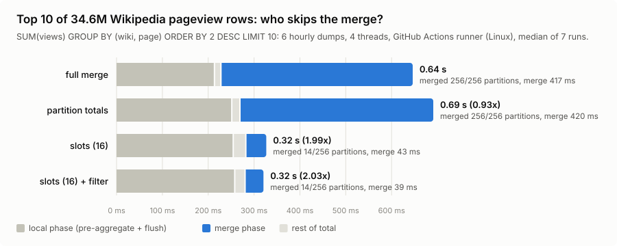
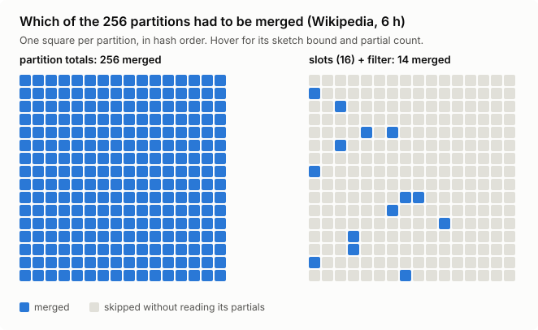
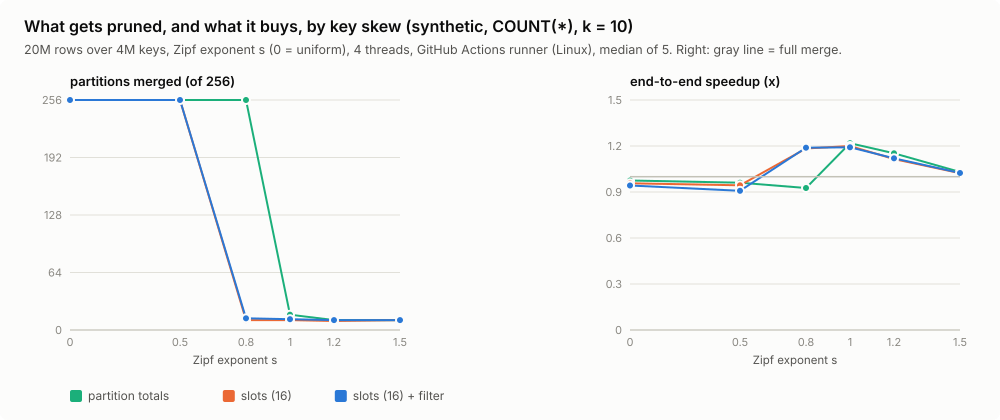
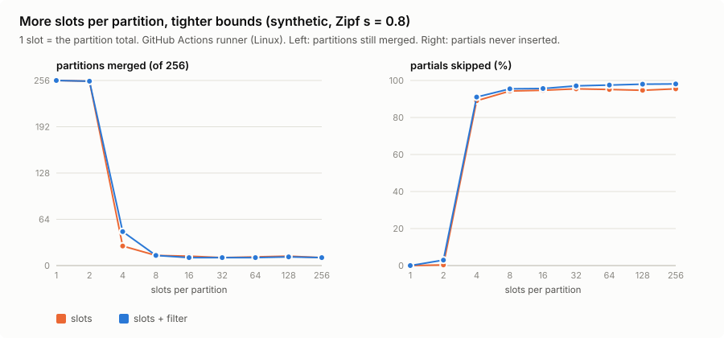

# groupcut

On six hours of Wikipedia pageviews (34.6M rows, 18.3M distinct pages), the
obvious way to prune a top-10 `GROUP BY` (skip any hash partition whose total
cannot reach the top 10) skips **0 of 256** partitions. Splitting each
partition's total into 16 hashed slot counters skips **242 of 256**. The merge
phase drops from 1.21 s to 68 ms (18x) and the query from 3.0 s to 2.1 s. The
answer is identical; the pruning is exact, not approximate.



groupcut is a small parallel aggregation engine in Rust (no dependencies) for
one query shape:

```sql
SELECT key, AGG(v) FROM t GROUP BY key ORDER BY AGG(v) DESC LIMIT k
```

It implements the radix-partitioned two-phase hash aggregation that analytical
databases use, plus the top-k pruning described in Pivot's post
[*Can GROUP BY still be optimized after all these years?*](https://pivotlake.io/blog/know-your-limit-faster-top-k-aggregation/)
(Oct 2026, on the HN front page this week), and measures it on real and
synthetic data. The post reports one end-to-end number (1.6x on ClickBench
Q16) and no ablation of the slot refinement. This repo isolates that mechanism, extends it
to SUM with negative values and to MAX, adds a per-slot filter inside the
partitions that still have to be merged, and checks every answer against a
naive reference.

## Quickstart

```sh
cargo test --release                       # unit + randomized differential tests (~30 s)
cargo run --release -- demo                # 20M synthetic rows, every strategy, checked against a reference

scripts/fetch-wiki.sh                      # 6 hourly pageview dumps, ~270 MB, CC0
cargo run --release -- wiki data/*.gz      # the headline query
cargo run --release -- bench               # the sweeps behind the charts (~15 min)
python3 scripts/plot.py                    # re-render assets/*.svg from bench/*.json
```

Real output of `groupcut wiki --threads 4 --reps 7 data/*.gz` on an 8 GB M2
MacBook Air (`bench/wiki-m2.txt`):

```
SELECT domain_code, page_title, SUM(count_views) FROM pageviews GROUP BY domain_code, page_title ORDER BY 2 DESC LIMIT 10

   1.     639163  en.m Main_Page
   2.     421216  en Main_Page
   3.     158413  en.m Wikipedia:Featured_pictures
   4.     150185  de Wikipedia:Hauptseite
   5.     130321  en.m Tung_Tung_Tung_Sahur
   6.     109430  commons.m.m File:LinkedIn_icon.svg
   7.     105945  de.m Wikipedia:Hauptseite
   8.      90311  en.m Special:Search
   9.      86861  en Special:Search
  10.      81265  ja.m メインページ

  strategy                total ms     local    sketch     merge  speedup  merge x partitions   skipped
  full merge                3022.9    1789.9       0.0    1212.2    1.00x    1.00x  256/256        0.0%
  partition totals          3525.3    2147.5       0.0    1233.8    0.86x    0.98x  256/256        0.0%
  slots (16)                2140.1    2064.2       0.1      67.5    1.41x   17.95x   14/256       94.5%
  slots (16) + filter       2120.0    2047.1       0.1      70.5    1.43x   17.20x   14/256       96.0%
  18341211 distinct pages, 34558052 partial aggregates across 256 partitions; answers identical across strategies
```

`skipped` is the share of phase-1 output that was never inserted into a merge
table. Times are medians of 7 runs.

## The idea

Parallel aggregation runs in two phases. In phase 1, every thread
pre-aggregates its rows and writes partial aggregates into P partitions chosen
by the high bits of the key's hash. In phase 2, each partition's partials from
all threads are merged into one hash table. Every group lives in exactly one
partition, so partitions can be merged independently and in parallel. With
`LIMIT 10`, nearly all of that merge work is thrown away.

**Partition totals.** While flushing partials, keep a running sum per
partition. No group can exceed the total of the partition it lives in. Merge
partitions in decreasing order of total while tracking τ, the 10th-best exact
value found so far. Once a partition's total is below τ, that partition and
every later one can be skipped unread.

This fails whenever a partition holds many moderate groups. In the Wikipedia
run the 10th-best page has 81,265 views, but the *smallest* partition total is
365,480: each partition holds ~72,000 pages, and their long tail adds up. No
partition is ever below τ.

**Slot counters.** Split each partition's counter into 2^b slots, chosen by
the hash bits right after the partition bits. A group's value is still at most
its slot's counter, so a partition's bound becomes its *largest* slot. The tail
is now divided 16 ways. With 16 slots the median partition bound falls to
33,859, below τ, and 242 of 256 partitions are skipped. Effectively this is a
one-row [Count-Min sketch](https://en.wikipedia.org/wiki/Count%E2%80%93min_sketch)
per partition, used for its one-sided error.

**Slot filter (added here).** The same counters work inside the partitions
that do get merged: a partial whose slot counter is below τ is not inserted at
all. The filter costs a hash and a lookup per partial, so it only runs in
partitions whose *smallest* slot counter is below τ. Elsewhere it could not
skip anything.



### Why the bound holds

A group's final value is a combination of its partials, which can come from
several threads and several flushes. The sketch combines a per-partial
*contribution* with an operator that can only overshoot:

| aggregate | final value of a group | contribution of a partial | combine |
|---|---|---|---|
| `COUNT(*)` | sum of partial counts | the partial | `+` |
| `SUM(v)`, any sign | sum of partial sums | `max(partial, 0)` | `+` |
| `MAX(v)` | max of partial maxima | the partial | `max` |

For SUM with negative values, summing raw partials would be wrong: a large
negative group in the same slot could cancel a positive one and push the
counter below a real value. Clamping each partial at zero gives a group total ≤
the sum of its positive partials ≤ the sum of every positive partial in its
slot. `tests/property.rs` checks the invariant directly
(`sketch_counters_bound_every_group`) and has a constructed case for the
cancellation (`negative_sums_do_not_break_the_bound`).

Every pruning test uses strict `<`. A group that could *tie* τ might still win
on key order (ties break by smaller key), so it is never skipped.

## Results

All numbers come from the scripts in this repo. `bench/*.txt` and
`bench/*.json` are the captured outputs, and the charts are rendered from the
JSON.

**Skew decides everything.** 20M rows over 4M keys, Zipf exponent s,
`COUNT(*)`, k = 10, 4 threads (`bench/results-m2.txt`). Each cell gives
partitions merged · merge-phase speedup · end-to-end speedup, relative to the
full merge:

| s | full merge | partition totals | slots (16) | slots (16) + filter |
|---|---|---|---|---|
| 0 (uniform) | 1278 ms (508 merge) | 256/256 · 0.9x · 0.76x | 256/256 · 0.8x · 0.67x | 256/256 · 1.1x · 0.96x |
| 0.5 | 1211 ms (395 merge) | 256/256 · 1.0x · 0.96x | 256/256 · 1.0x · 1.08x | 256/256 · 1.0x · 0.96x |
| **0.8** | 1226 ms (345 merge) | **256/256** · 1.1x · 1.17x | **11/256** · 17.2x · 1.26x | **11/256** · 14.6x · 1.33x |
| 1.0 | 598 ms (142 merge) | 17/256 · 13.9x · 1.04x | 11/256 · 18.8x · 1.03x | 11/256 · 25.1x · 1.06x |
| 1.2 | 182 ms (28 merge) | 10/256 · 21.7x · 0.90x | 11/256 · 15.5x · 1.02x | 11/256 · 27.4x · 1.16x |
| 1.5 | 76 ms (3 merge) | 10/256 · 6.7x · 1.03x | 10/256 · 7.8x · 0.99x | 10/256 · 8.4x · 0.99x |



- Below s ≈ 0.5, nothing can be pruned: the top 10 are not far enough above
  the crowd. No sketch can change that.
- At s = 0.8 the data looks like the Wikipedia data: partition totals prune
  nothing and slots prune 96%.
- From s = 1.0 on, the heavy hitters are heavy enough that partition totals
  work too. Slots add a little; the filter adds a little more.
- End to end, the gain on synthetic data is small (1.0-1.3x), because
  pre-aggregation collapses repeated keys in phase 1 and leaves less for phase
  2. On the Wikipedia data every (wiki, page) appears once per hourly file, so
  phase 1 can't reduce anything, the merge is 40% of the query, and pruning it
  pays 1.4x.

**How many slots?** At s = 0.8 the ablation (`assets/slots.svg`) shows a
cliff, not a slope. 1 or 2 slots merge 255-256 partitions, 4 slots merge 27,
8 merge 12, and 16-256 slots all merge 11. Past 16 slots the bounds are
already below τ and more counters just cost memory (P × slots × 8 bytes per
thread). 16 is the default.



**k matters.** At s = 1.0, k = 1 skips 98% of partials and k = 10 skips
96-97%. k = 100 still skips 57% (80% with the filter). By k = 1000, τ is so low that
every partition has a slot above it and nothing is pruned
(`bench/results-m2.txt`, k sweep).

**More partitions prune better.** With 4096 partitions only 12-13 are merged
and the merge phase is 84-146x faster. Even plain partition totals work at
that size, because each partition's tail is 16 times smaller than at 256. Slots
get similar tightness without multiplying partitions, buffers and per-partition
overhead. That fits the post's point that a top-10 can touch at most 10
partitions with real winners.

**Overhead when nothing can be pruned.** Uniform keys, one thread, best of 15
(`bench/overhead-m2.txt`): +7% (sketch only) and +11% (with filter) vs the
full merge. A second run of the same command gave +6% and -5%. The cost is one
add per partial in phase 1 plus a sort of 256 bounds, and it sits below what
this machine can resolve. See the caveat below.

### A caveat about these timings

The M2 these numbers come from had 8 GB of RAM, other applications holding
most of it, ~8 GB of swap in use, and a load average around 6 from unrelated
processes. Look at the `local` column: phase 1 does *identical* work under
every strategy, yet its median varies by ±20% between rows. Treat any
end-to-end difference under ~20% in these tables as noise. The partition and
partial counts are exact, and the merge-phase speedups (10-30x) are far
outside the noise. `.github/workflows/bench.yml` reruns the whole thing on a
GitHub-hosted runner for an independent measurement.

## What is implemented

- `src/engine.rs`: the two-phase engine.
  - **Phase 1** is morsel-driven: threads pull 64K-row ranges from a shared
    cursor ([Leis et al. 2014](https://db.in.tum.de/~leis/papers/morsels.pdf)),
    so a slow core takes fewer morsels instead of stalling the phase. Each
    thread aggregates into a fixed 16K-bucket table (256 KB, cache-resident).
    When the table reaches 5/8 load it flushes every entry as a partial into
    one of P per-thread buffers and resets. This is DuckDB's design for
    [parallel grouped aggregation](https://duckdb.org/2022/03/07/aggregate-hashtable.html).
    The sketch is updated during the flush, which touches every partial
    anyway.
  - **Sketch step:** per-thread counters are combined, and partitions get
    their bound (max slot) and their smallest slot, then are sorted by bound.
  - **Phase 2:** workers take partitions in bound order from an atomic index.
    Each one checks the shared τ (an `AtomicI64` that only grows), merges or
    skips, takes the partition's local top k, and folds it into a
    mutex-guarded global heap.
- `src/table.rs`: linear-probing table of `(u64, i64)` buckets. `0` marks an
  empty bucket, and the real key `0` lives in a side field, so a new table is
  a zeroed allocation (OS zero pages, no fill pass). Growable for phase 2,
  fixed for phase 1.
- `src/hash.rs`: one 64-bit hash per key (Murmur3 finalizer), split into
  disjoint fields: partition (top bits), slot (next bits), probe position
  (low bits).
- `src/agg.rs`: COUNT, SUM, MAX as monomorphized ops with their bound rules.
- `src/topk.rs`: bounded heap; order is value descending, then key ascending,
  so every query has exactly one correct answer.
- `src/wiki.rs`: streams `.gz` dumps through `gzip -dc` and hashes
  `(domain, title)` to 64-bit keys. When printing the answer it re-reads the
  files to recover the names and flags any key two different strings hash to,
  so a collision in the reported top k cannot go unnoticed.
- `src/main.rs`: `demo`, `bench` and `wiki`. Strategies are run interleaved
  round-robin, with the starting strategy rotated every round. An early version
  ran them in a fixed order, and whichever ran first in a round came out ~25%
  faster for no algorithmic reason.

## Testing

`cargo test --release` runs:

- **Differential test:** 400 random workloads × 3 aggregates × 3 random
  configurations (threads 1-8, 1-256 partitions, 1-64 slots, filter on/off,
  pre-aggregation tables of 16 to 8K buckets), 3,600 runs in all. Every answer
  must equal a `HashMap` + sort reference exactly, including tie order. The
  workloads include empty input, k = 0, k larger than the number of groups,
  all-negative values, values near ±2^40, and the keys `0` and `u64::MAX`.
- **Bound invariant** checked directly against true group values, plus the
  negative-sum cancellation case.
- **Ties:** 5,000 groups with identical counts must return the 25 smallest
  keys under every slot setting. A `<=` in any pruning test fails this.
- **Liveness:** skewed data must actually prune (>200 of 256 partitions), and
  uniform data must prune nothing and still be exact.
- **Determinism** across 1-12 threads. The hash table, top-k heap, generator
  and Zipf sampler have their own unit tests.

CI runs fmt, clippy (`-D warnings`), the tests and a small demo on Linux and
macOS.

## Design decisions and trade-offs

- **Exact, not approximate.** Approximate top-k (Space-Saving, Count-Min
  heavy hitters) is cheaper but gives a different answer. Here the sketch only
  decides what to skip. The merge itself is exact, so the answer is the same
  as with no pruning.
- **Sketch on flush, not per row.** Updating counters per input row would put
  an extra memory write in the hottest loop. Flushes see each distinct key in
  a morsel once.
- **Visit partitions in bound order.** τ rises as fast as possible, and once
  one partition is skipped, every later one is too (bounds only decrease, τ
  only increases).
- **Fixed-width keys.** String keys are hashed to 64 bits up front. A real
  engine would keep the strings and compare them on collision. Here a
  collision would merge two groups. At 18M keys the chance of any collision
  is about 10^-5, and the answer path checks for one explicitly.
- **One τ for everyone.** Workers share τ through an atomic. A worker reads it
  once per partition, so it may use a slightly stale (lower) value. That is
  always safe; it just prunes a bit less.

## Limitations

- Only `ORDER BY agg DESC`. `ORDER BY COUNT(*) ASC` has no useful upper bound
  (every group is ≥ 1), and `MIN ... ASC` would need the mirror-image sketch.
  Neither is implemented.
- One aggregate per query, `i64` values, keys hashed to `u64`. No spilling, no
  NULLs, no `HAVING`.
- The phase-1 pre-aggregation table always runs. On the Wikipedia data, keys
  never repeat within a morsel, so it reduces nothing. Detecting that and
  bypassing it would shrink phase 1 and make the merge, and therefore pruning,
  a larger share of the query.
- When the k-th value is not well separated from the bulk (uniform keys, or k
  in the thousands), nothing is pruned and you pay a small overhead.
- Benchmarks were run on one noisy laptop. See the caveat above.

## References

- Gilad Kleinman, [*Can GROUP BY still be optimized after all these years?*](https://pivotlake.io/blog/know-your-limit-faster-top-k-aggregation/),
  Pivot blog, 27 Oct 2026. Source of the partition-total and slot pruning idea
  ([Pivot source](https://github.com/pivotlake/pivot/)).
- Leis, Boncz, Kemper, Neumann, *Morsel-Driven Parallelism*, SIGMOD 2014.
- Raasveldt, [*Parallel Grouped Aggregation in DuckDB*](https://duckdb.org/2022/03/07/aggregate-hashtable.html), 2022.
- Fagin, Lotem, Naor, *Optimal Aggregation Algorithms for Middleware*
  (the Threshold Algorithm), PODS 2001: the same "stop when the bound
  falls below the k-th value" idea, for top-k over sorted lists.
- Cormode, Muthukrishnan, *An Improved Data Stream Summary: The Count-Min
  Sketch and its Applications*, 2005.
- [ClickBench](https://benchmark.clickhouse.com/), where most queries have
  this shape.
- Data: [Wikimedia pageview dumps](https://dumps.wikimedia.org/other/pageviews/),
  2026-11-01 12:00-17:00 UTC, CC0.

## License

MIT
