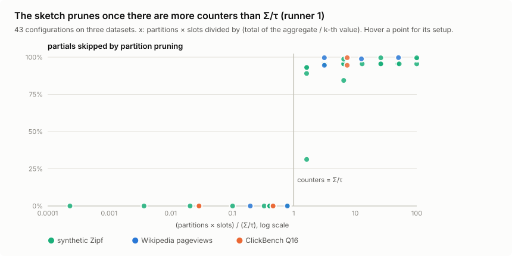

# groupcut

An independent reimplementation and test of the top-k pruning described in
Pivot's [*Can GROUP BY still be optimized after all these years?*](https://pivotlake.io/blog/know-your-limit-faster-top-k-aggregation/)
(October 2026), for queries of the form
`SELECT key, AGG(v) ... GROUP BY key ORDER BY AGG(v) DESC LIMIT k`. It is a
parallel hash-aggregation engine in Rust (no dependencies). It keeps a small
sketch of upper bounds per hash partition and skips the partitions that
cannot contain one of the top k. Answers are exact.

**The finding:** the sketch prunes once its number of counters
(partitions × slots) exceeds **Σ/τ**, the total of the aggregate divided by
the k-th best value. Below that, it prunes essentially nothing. Over 43
configurations on three datasets:

- the 15 with fewer than 0.81 × Σ/τ counters skipped at most 0.35% of the
  merge input (one partition, once);
- the 28 with more than 1.6 × Σ/τ skipped at least 31%, and at least 84%
  everywhere except one 16-partition setup.

No configuration landed between 0.81 and 1.6, so the exact crossover isn't
pinned down.



Two of those datasets show both sides of the rule:

- **Wikipedia pageviews** (6 hours, 34.6M rows, Σ/τ ≈ 1,300). The default
  256 partitions × 16 slots skip 242 of 256 partitions. The query runs
  **1.8-2.0x faster** than a full merge on three separate GitHub Actions
  runners. One counter per partition (the post's first version) prunes
  nothing until 4096 partitions, and even there it is 1.4-1.6x slower than
  256 × 16.
- **ClickBench Q16**, the query the post measured (20 of the 100 `hits`
  partitions, 20M rows, Σ/τ ≈ 8,900). The same 256 × 16 setting prunes
  **nothing**. It takes 65,536 counters (256 × 256 or 4096 × 16) to skip
  95-99% of the merge, and then the query is 1.11-1.23x faster. The post
  reports 1.6x on the full 100M rows.

Every answer is checked against a naive `HashMap` + sort reference. The
Wikipedia top 10 is also identical to DuckDB's.

## Why the rule holds

A typical slot counter is about Σ/(P·S), and a partition can only be skipped
if all its counters are below τ. So P·S must exceed Σ/τ before any skipping
happens. A few slots stay above τ because they contain the actual winners;
those are the ~k partitions that still get merged. Σ/τ is large when the k-th
value is a small share of the total: little skew, many groups, or a large k.
At k = 1000 nothing prunes on any of the datasets here.

The post's per-partition total is the case S = 1. It works when P alone
exceeds Σ/τ (synthetic Zipf with s ≥ 1, where Σ/τ ≈ 160) and fails on the
pageviews, where the smallest of 256 partition totals is 365,480 against
τ = 81,265.

## Quickstart

```sh
cargo test --release                                    # ~2 min cold build, then seconds
cargo run --release -- demo                             # 20M Zipf(0.8) rows, all strategies vs the reference
scripts/fetch-wiki.sh                                   # 6 hourly pageview dumps, ~300 MB, CC0
cargo run --release -- wiki --check data/*.gz           # the Wikipedia query
uv run --with duckdb --with numpy python scripts/clickbench_q16.py --files 20
cargo run --release -- keys --check --slot-bits 8 data/q16.u64   # Q16 with 256 x 256 counters
cargo run --release -- bench                            # synthetic sweeps (5-15 min)
cargo run --release --example sigma_tau                 # Σ/τ for the synthetic workloads
python3 scripts/plot.py                                 # re-render assets/ from bench/gha/run1
```

`.github/workflows/bench.yml` runs all of it on three runners in parallel.
The outputs are in `bench/gha/run{1,2,3}/`; absolute times differ by up to
45% between runners, while ratios and partition counts don't. First runner,
`wiki --check` (query time only, after a ~3 s load):

```
  strategy                total ms     local    sketch     merge  speedup  merge x partitions   skipped
  full merge                 643.0     213.6       0.0     416.8    1.00x    1.00x  256/256        0.0%
  partition totals           688.1     250.6       0.0     423.8    0.93x    0.98x  256/256        0.0%
  slots (16)                 323.8     254.1       0.0      42.0    1.99x    9.93x   14/256       94.5%
  slots (16) + filter        317.5     257.9       0.1      38.5    2.03x   10.82x   14/256       96.0%
```

## How it works

**Phase 1.** Threads pull 64K-row morsels and aggregate them in a
cache-resident 16K-bucket table. When it is 5/8 full, every entry is flushed
as a partial aggregate into one of P per-thread buffers, chosen by the high
bits of the key's hash. If a flush shows the table reduced the rows by less
than 10%, the thread scatters the next 16 morsels directly into the buffers,
then probes again. This happens on the pageview data, where each (wiki, page)
appears once per file.

**Phase 2.** Each partition's partials from all threads are merged into one
hash table, and its top k is folded into a shared heap. A group lives in
exactly one partition, so partitions merge independently.

**Pruning.** During the flush, each partial is also added to one of 2^b
counters of its partition, chosen by the hash bits after the partition bits.
A group's final value is at most its slot's counter, and a partition's bound
is its largest counter. Workers take partitions in decreasing bound order and
share τ, the k-th best exact value found so far. A partition whose bound is
below τ is skipped unread, and so is everything after it. The optional
`filter` also skips individual partials whose own slot is below τ.


**Correctness.** Partials of one group can come from several threads and
flushes, so counters combine per-partial contributions with operators that
can only overshoot:

| aggregate | contribution of a partial | combine |
|---|---|---|
| `COUNT(*)` | the partial | `+` (saturating) |
| `SUM(v)`, any sign | `max(partial, 0)` | `+` (saturating) |
| `MAX(v)` | the partial | `max` |

The clamp matters: without it, a large negative group sharing a slot could
pull the counter below a real value. Pruning uses strict `<`, because a group
that ties τ can still win on key order. τ only grows (it is written under the
heap's lock), so a stale read prunes less but never wrongly. SUM panics on
`i64` overflow, since a wrapped partial would break the bound.

## More results

From `bench/gha/` (Linux, 4 vCPU, medians of 5-7 runs, three runners).

**Wikipedia by partition count** (runner 1):

| partitions × slots | full merge | partition totals (× 1) | slots (× 16) + filter |
|---|---|---|---|
| 256 | 643 ms | 688 ms, merged 256/256 | **318 ms**, merged 14 |
| 1024 | 570 ms | 604 ms, merged 1024/1024 | 384 ms, merged 12 |
| 4096 | 602 ms | 448 ms, merged 17 | 484 ms, merged 13 |

The sketch slows phase 1 by 15-21%, because every partial updates a counter.
At 4096 × 16 the counters (512 KB per thread) no longer fit in cache, which is
why slots lose to totals there. Forcing pre-aggregation on (`--adaptive 0`)
makes every strategy slower, and pruning then gains 1.5-1.7x instead of
1.8-2.0x.

**ClickBench Q16, 20M rows** (runner 1; DuckDB 2.0 on the same runner and
data for scale):

| counters | full merge | slots (+ filter) | skipped |
|---|---|---|---|
| 256 × 16 | 135 ms | 141 ms (0.96x) | 0% |
| 256 × 256 | 135 ms | 110 ms (1.22x) | 98% |
| 4096 × 16 | 150 ms | 133 ms (1.13x) | 99.5% |
| DuckDB, Q16 as written | 460 ms | | |
| DuckDB, same 64-bit hashed key | 191 ms | | |

Q16 gains less than the pageviews. Pre-aggregation collapses 20M rows into
~6.3M partials, so the merge is only a quarter of the query.

**Synthetic Zipf(s)**, 20M rows over 4M keys, k = 10, 256 partitions:

| s | Σ/τ | full merge | totals (256 counters) | slots ×16 + filter (4096) |
|---|---|---|---|---|
| 0.5 | 12,369 | 257 ms | merged 256 · 0.97x | merged 256 · 0.93x |
| 0.8 | 632 | 286 ms | merged 256 · 0.95x | merged 11 · 1.35x |
| 1.0 | 157 | 195 ms | merged 17 · 1.27x | merged 11 · 1.24x |
| 1.5 | 83 | 37 ms | merged 11 · 1.03x | merged 11 · 1.03x |

At s = 0.8 the slot ablation crosses the threshold where the rule says it
should: 2 slots (512 counters) merge 255 partitions, and 4 slots (1,024)
merge 27. When nothing can be pruned, the sketch costs -6% to +9%
single-threaded across runners, and up to 12% at 4 threads.

## Tests

`cargo test --release`:

- **Differential tests:** 3,600 random runs against the reference, tie order
  included. They vary threads, partitions, slots, pre-aggregation size,
  morsel size (so phase 1 really runs in parallel), the bypass and the filter,
  over empty inputs, k = 0, k above the group count, all-negative and ±2^40
  values, and the keys `0` and `u64::MAX`.
- **The bound invariant**, checked directly against true group values.
- **One test per correctness rule**, each verified to fail when its rule is
  mutated: the SUM clamp, strict `<` at the partition level and in the
  filter, checked SUM overflow, and the bypass path.
- **Input errors:** a missing or truncated `.gz` must be an error, never a
  smaller answer.

CI runs fmt, clippy `-D warnings`, the tests and the demo on Linux and macOS.

## Limitations

- The rule tells you whether a configuration *can* prune, but the engine
  doesn't pick S from it: τ isn't known until phase 2. Choosing slots from a
  sampled τ is the obvious next step and isn't implemented.
- Only `ORDER BY agg DESC` with COUNT, SUM or MAX, one aggregate, `i64`
  values, no NULLs, no spilling.
- Keys are 64-bit hashes of the grouping columns. A collision would merge two
  groups (chance ~10^-5 at 18M keys). `wiki` re-reads the input and flags any
  collision among the winners.
- The first T partitions (T = threads) are always merged, because τ is
  unknown until one finishes. Merged counts vary by 1-3 between runs.
- Q16 was run on 20% of `hits`, not the full table.

## References

- Gilad Kleinman, [*Can GROUP BY still be optimized after all these years?*](https://pivotlake.io/blog/know-your-limit-faster-top-k-aggregation/),
  Pivot blog, 27 Oct 2026 ([source](https://github.com/pivotlake/pivot/)).
- Leis, Boncz, Kemper, Neumann, *Morsel-Driven Parallelism*, SIGMOD 2014.
- Raasveldt, [*Parallel Grouped Aggregation in DuckDB*](https://duckdb.org/2022/03/07/aggregate-hashtable.html), 2022.
- Fagin, Lotem, Naor, *Optimal Aggregation Algorithms for Middleware*, PODS 2001.
- Cormode, Muthukrishnan, *An Improved Data Stream Summary: The Count-Min Sketch*, 2005.
- Data: [Wikimedia pageview dumps](https://dumps.wikimedia.org/other/pageviews/)
  (2026-11-01 12:00-17:00 UTC, CC0) and [ClickBench](https://github.com/ClickHouse/ClickBench) `hits`.

## License

MIT
